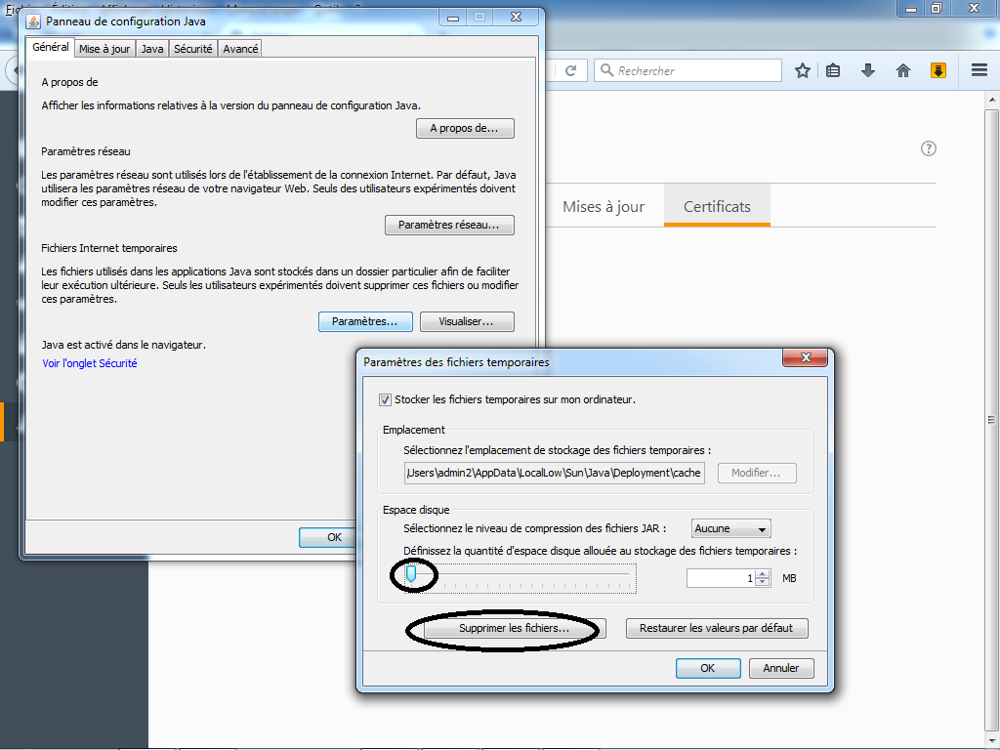
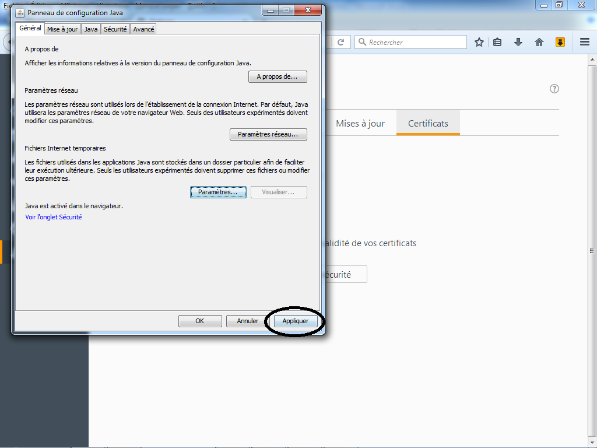
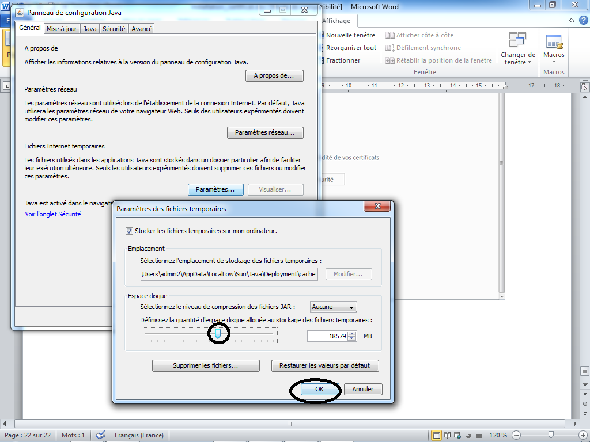
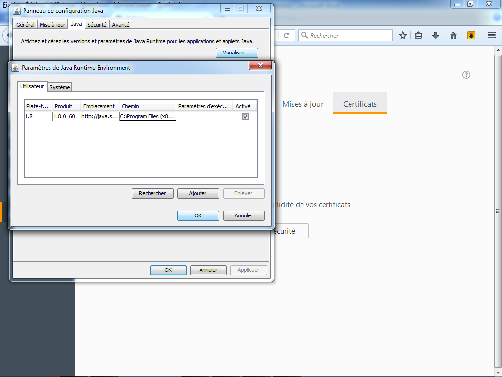

# Dépannage

Ces fiches sont à utiliser uniquement si INDIM@J ne fonctionne pas correctement après l'installation.

!!! tip "Certificat expiré ?"
    Si Firefox affiche le code `SSL_ERROR_EXPIRED_CERT_ALERT`, suivez plutôt le guide [Renouvellement du certificat](../renouvellement/index.md).

## A — Vider les fichiers temporaires de Java { #dep-a }

<figure markdown="span">
  { width="760" }
  <figcaption>Java › Général › Paramètres des fichiers temporaires (sous-étapes 1 à 3)</figcaption>
</figure>

1. Dans le panneau Java, onglet **Général**, cliquez sur **Paramètres…** (Fichiers Internet temporaires).
2. Cliquez sur **Supprimer les fichiers…** et confirmez.
3. Placez le curseur d'espace disque sur **0**, puis cliquez sur **OK**.
4. Cliquez sur **Appliquer**.
5. Rouvrez **Paramètres…** et remettez la taille de stockage à sa valeur précédente, puis cliquez sur **OK**.
6. Cliquez à nouveau sur **Appliquer**.

<figure markdown="span">
  { width="560" }
  <figcaption>Appliquer la modification (sous-étape 4)</figcaption>
</figure>

<figure markdown="span">
  { width="560" }
  <figcaption>Rétablir la taille de stockage (sous-étapes 5 et 6)</figcaption>
</figure>

## B — Vérifier qu'une seule version de Java est installée { #dep-b }

<figure markdown="span">
  { width="760" }
  <figcaption>Java › onglet Java › Visualiser</figcaption>
</figure>

1. Dans le panneau Java, cliquez sur l'onglet **Java** puis sur **Visualiser…**
2. Vérifiez qu'**une seule ligne** apparaît dans la liste.
3. Si plusieurs versions apparaissent, désinstallez les autres via **Panneau de configuration** › **Programmes et fonctionnalités**.

!!! info "Le problème persiste ?"
    Contactez l'équipe INDIM@J : [equipe_indimaj@tgr.gov.ma](mailto:equipe_indimaj@tgr.gov.ma)
