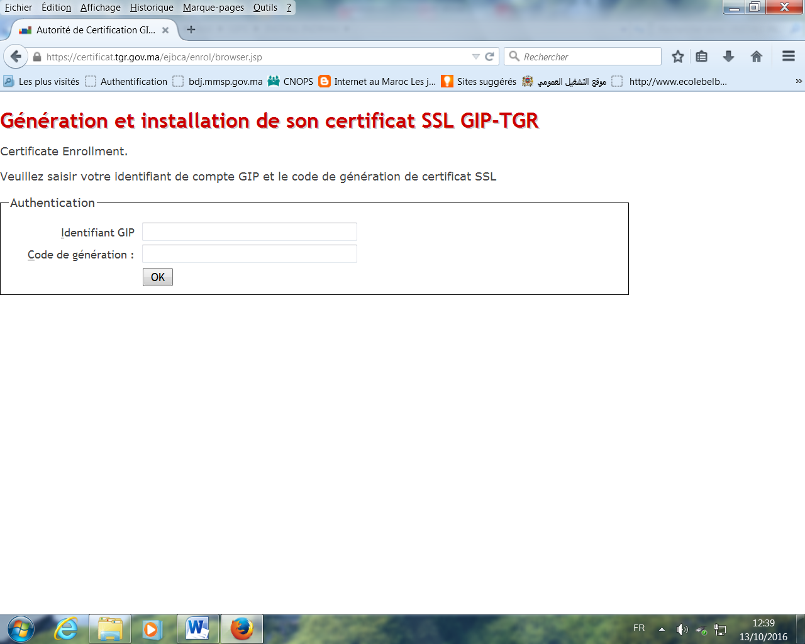
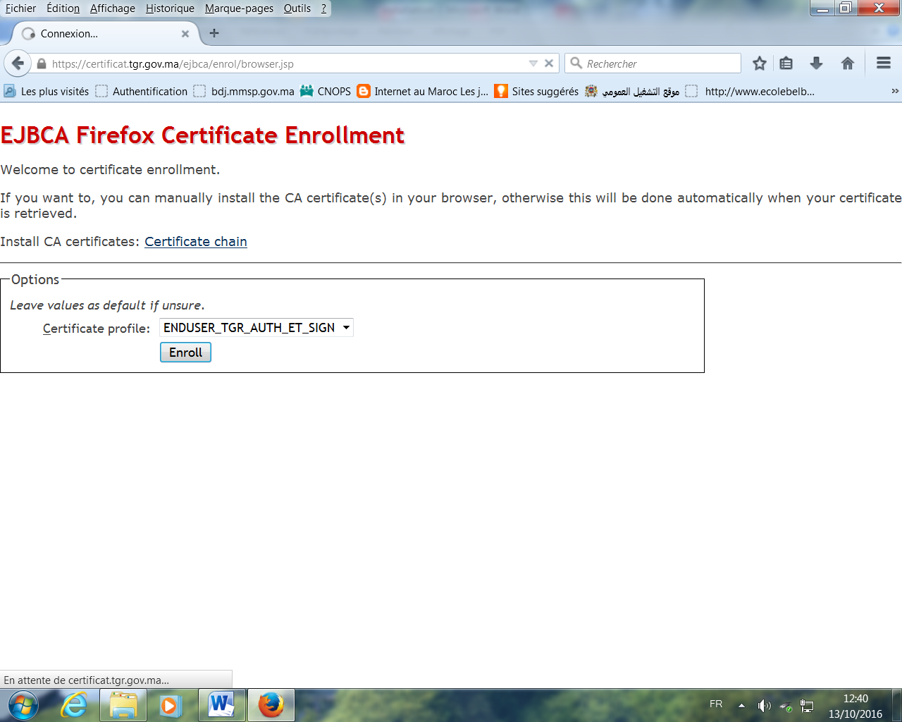
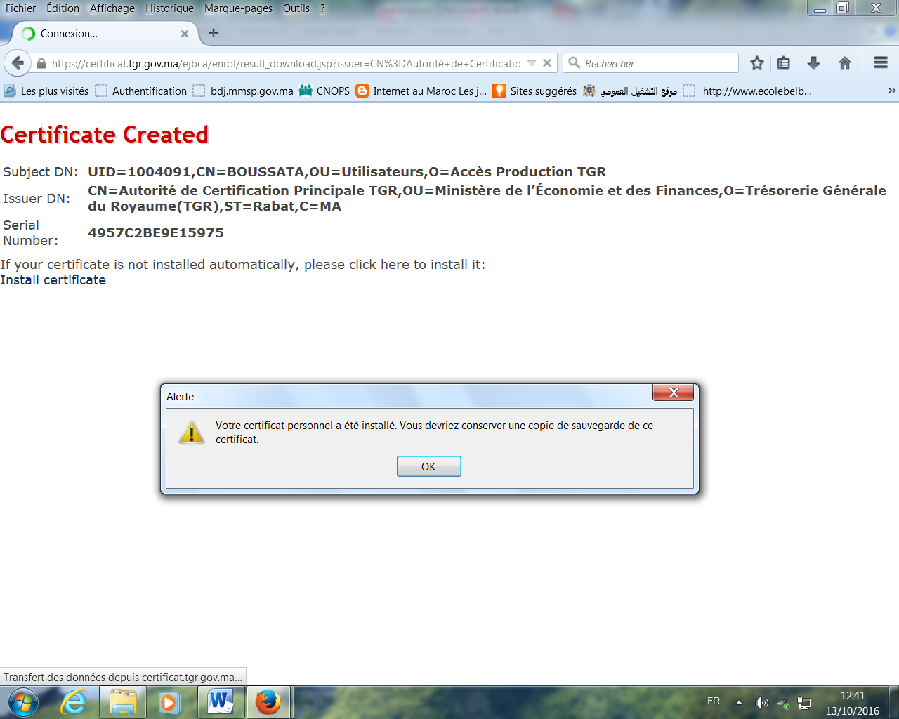
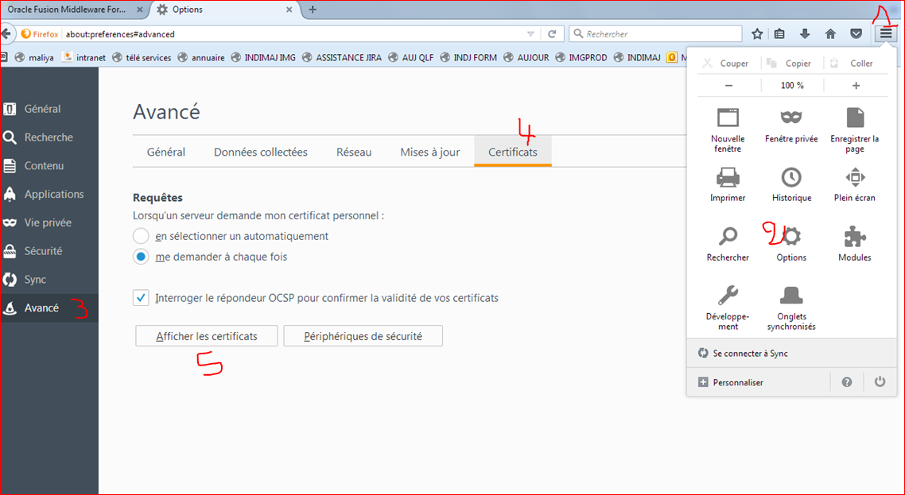
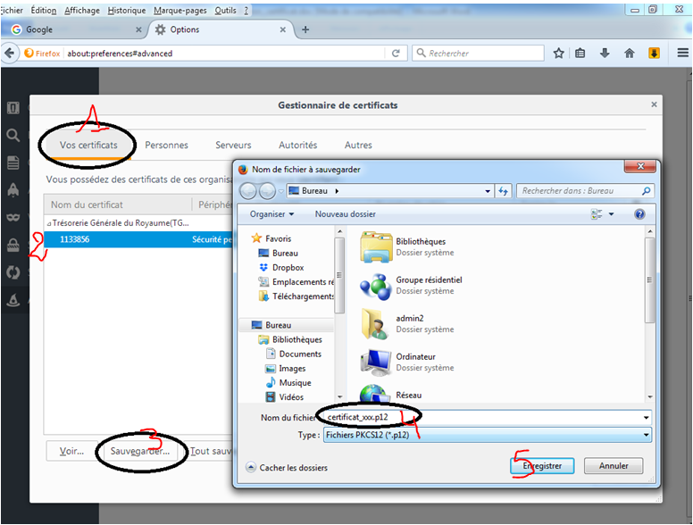
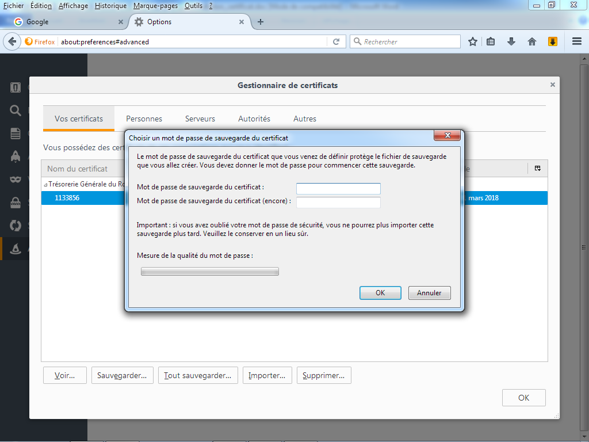
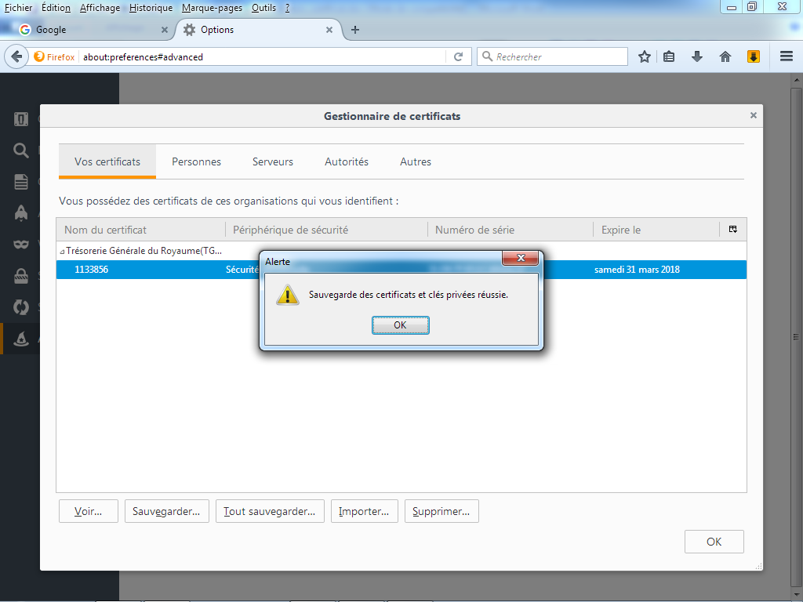

# Phase 2 — Créer et sauvegarder le certificat

!!! warning "Navigateur obligatoire"
    Cette phase doit être réalisée avec **Firefox 52 ESR** : Basilisk ne permet pas d'installer le certificat.

## Étape 4 — Se connecter au portail du certificat { #etape-4 }

<figure markdown="span">
  { width="760" }
  <figcaption>https://certificat.tgr.gov.ma</figcaption>
</figure>

1. Dans **Firefox**, accédez à l'adresse **[https://certificat.tgr.gov.ma](https://certificat.tgr.gov.ma){ target="_blank" }**.
2. Saisissez votre **Identifiant GIP** et votre **Code de génération**.
3. Cliquez sur **OK**.

!!! info "Bon à savoir"
    L'identifiant GIP et le code de génération sont normalement identiques à votre login INDIM@J.

## Étape 5 — Générer le certificat { #etape-5 }

<figure markdown="span">
  { width="760" }
  <figcaption>EJBCA Firefox Certificate Enrollment</figcaption>
</figure>

1. Laissez le profil proposé par défaut : **ENDUSER_TGR_AUTH_ET_SIGN**.
2. Cliquez sur **Enroll**.
3. La page **Certificate Created** confirme la création du certificat.
4. Une alerte indique que le certificat personnel a été installé : cliquez sur **OK**.

<figure markdown="span">
  { width="760" }
  <figcaption>Résultat attendu : le certificat est créé puis installé automatiquement dans Firefox</figcaption>
</figure>

## Étape 6 — Ouvrir le gestionnaire de certificats de Firefox { #etape-6 }

<figure markdown="span">
  { width="760" }
  <figcaption>Firefox › Options › Avancé › Certificats</figcaption>
</figure>

1. Ouvrez le menu **☰** en haut à droite de Firefox.
2. Cliquez sur **Options**.
3. Cliquez sur **Avancé**…
4. … puis sur l'onglet **Certificats**.
5. Cliquez sur **Afficher les certificats**.

## Étape 7 — Sauvegarder le certificat { #etape-7 }

<figure markdown="span">
  { width="760" }
  <figcaption>Gestionnaire de certificats › Vos certificats</figcaption>
</figure>

1. Cliquez sur l'onglet **Vos certificats**.
2. Sélectionnez le **nouveau certificat**.
3. Cliquez sur **Sauvegarder…**
4. Choisissez un emplacement, donnez un nom au fichier, puis cliquez sur **Enregistrer**.
5. Saisissez deux fois un **mot de passe de sauvegarde** (les champs peuvent être laissés vides), puis cliquez sur **OK**.
6. Le message **Sauvegarde des certificats et clés privées réussie** s'affiche : cliquez sur **OK**.

<figure markdown="span">
  { width="560" }
  <figcaption>Mot de passe de sauvegarde</figcaption>
</figure>

<figure markdown="span">
  { width="560" }
  <figcaption>Résultat attendu : la sauvegarde du certificat et des clés privées a réussi</figcaption>
</figure>

!!! warning "À retenir"
    Notez l'emplacement du fichier (.p12) et le mot de passe de sauvegarde : ils sont demandés à l'[étape 12](../java/index.md#etape-12).
