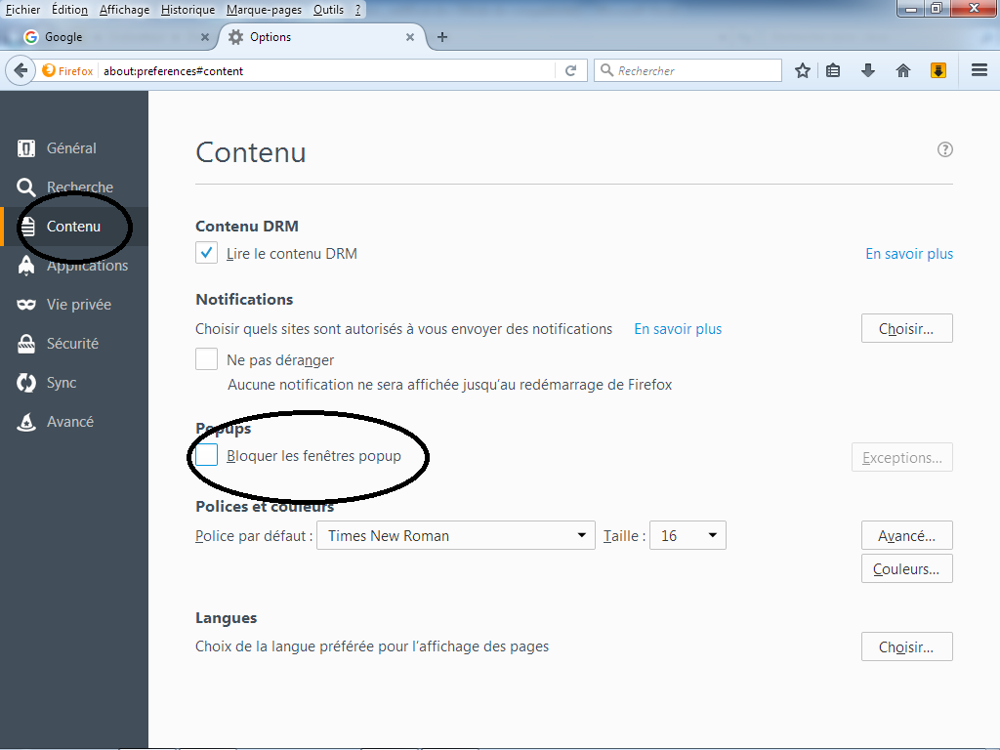
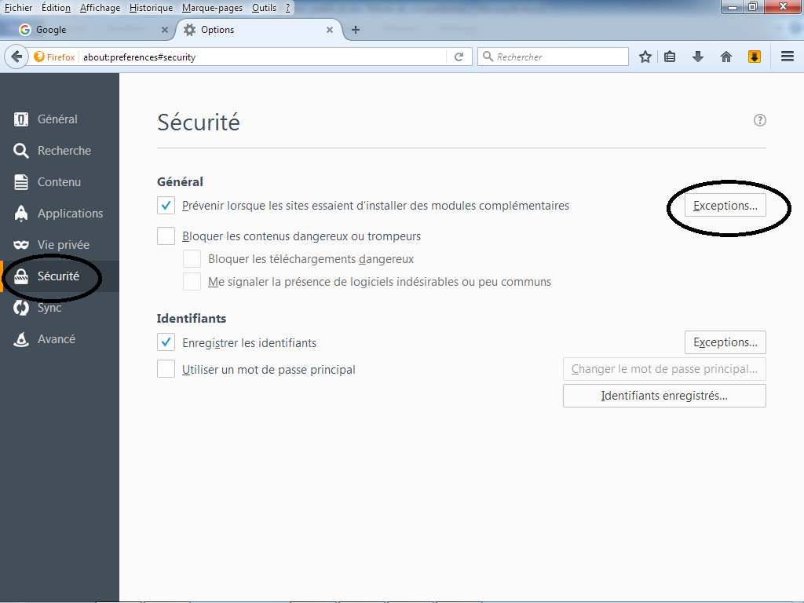
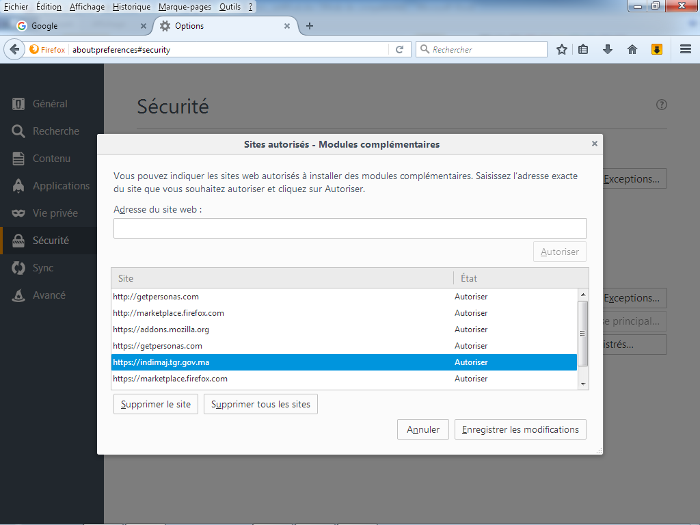

# Phase 4 — Finaliser la configuration de Firefox

!!! info "Si vous utilisez Basilisk"
    Appliquez aussi les réglages de cette phase dans Basilisk.

## Étape 15 — Autoriser les fenêtres popup { #etape-15 }

<figure markdown="span">
  { width="760" }
  <figcaption>Firefox › Options › Contenu</figcaption>
</figure>

1. Dans Firefox, ouvrez le menu **☰** puis **Options**.
2. Cliquez sur **Contenu**.
3. Décochez **Bloquer les fenêtres popup**.

!!! warning "Important"
    Sans cette option, les éditions INDIM@J ne peuvent pas s'afficher.

## Étape 16 — Ajouter INDIM@J aux exceptions de Firefox { #etape-16 }

<figure markdown="span">
  { width="760" }
  <figcaption>Firefox › Options › Sécurité</figcaption>
</figure>

1. Dans les **Options** de Firefox, cliquez sur **Sécurité**.
2. En face de **Prévenir lorsque les sites essaient d'installer des modules complémentaires**, cliquez sur **Exceptions…**
3. Saisissez **https://indimaj.tgr.gov.ma** puis cliquez sur **Autoriser**.
4. Cliquez sur **Enregistrer les modifications**.

<figure markdown="span">
  { width="560" }
  <figcaption>Résultat attendu : le site figure dans la liste avec l'état « Autoriser »</figcaption>
</figure>

!!! success "Installation terminée"
    Le poste est prêt. Contrôlez-le avec la [liste de vérification finale](../verification/index.md), puis connectez-vous à INDIM@J.

!!! info "Documentation INDIM@J"
    La documentation complète du système est disponible dans le [dossier Google Drive de la documentation](https://drive.google.com/drive/folders/16wpMRpNEnHUsIAdGSu--Yr3b4I3sQGaI?usp=drive_link){ target="_blank" }.
