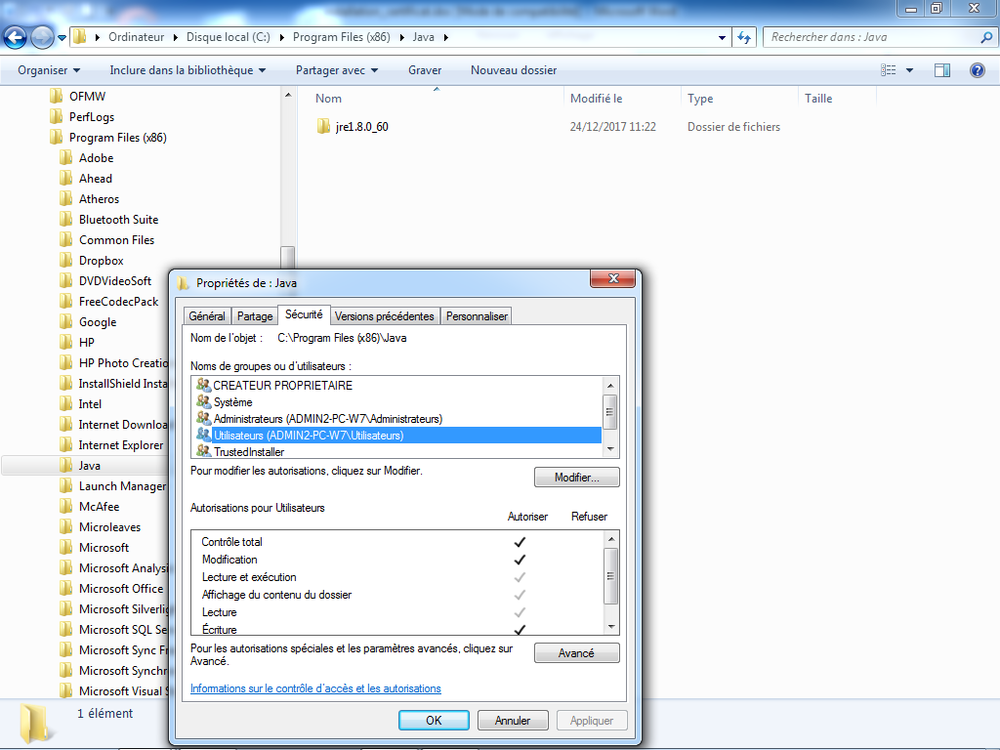
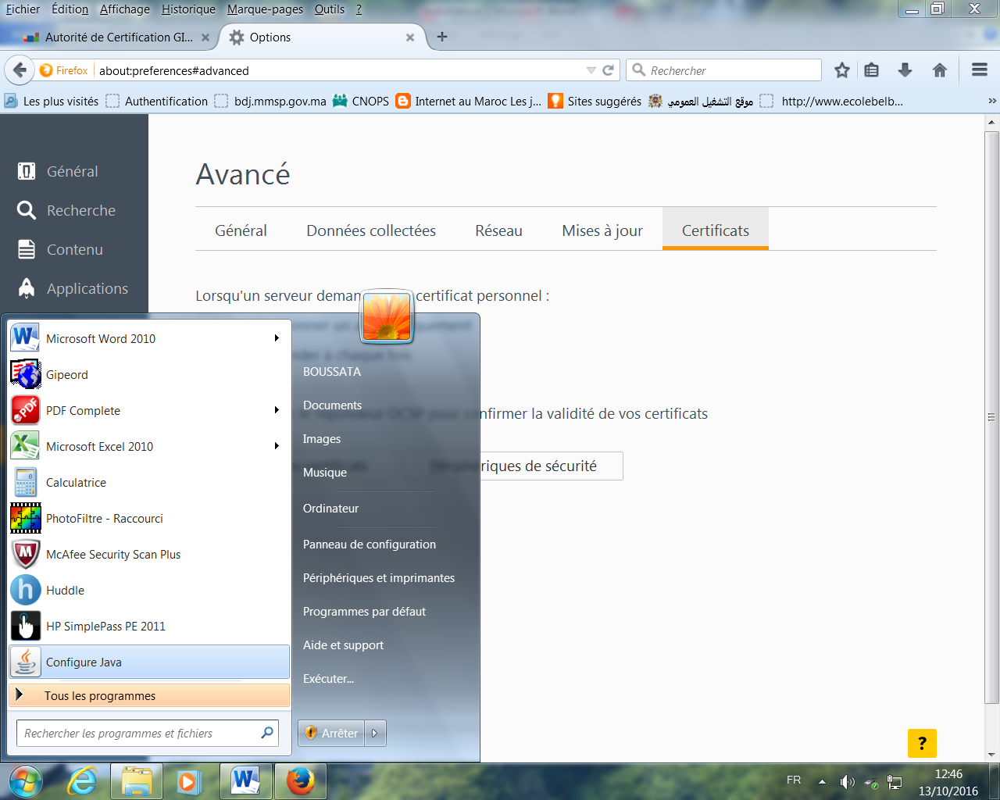
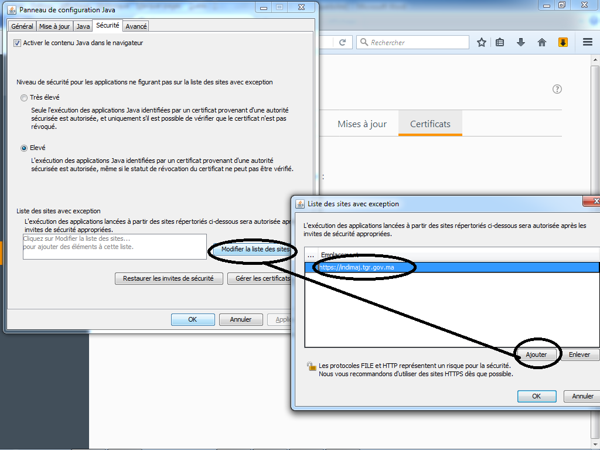
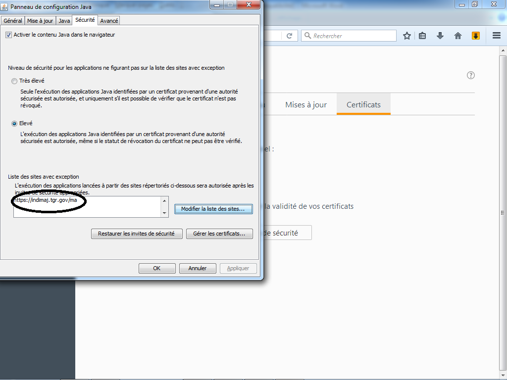
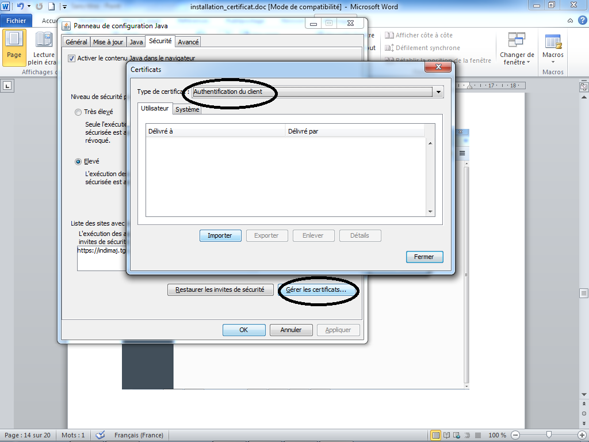
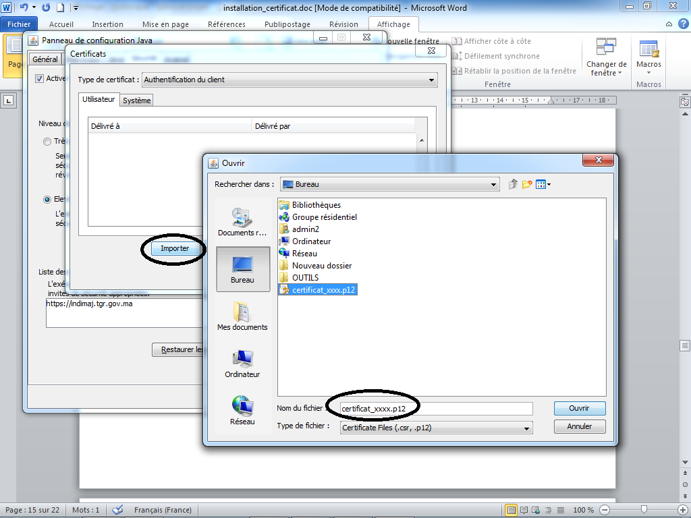
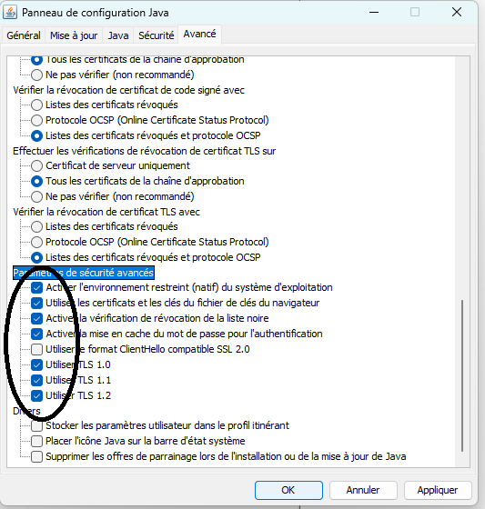
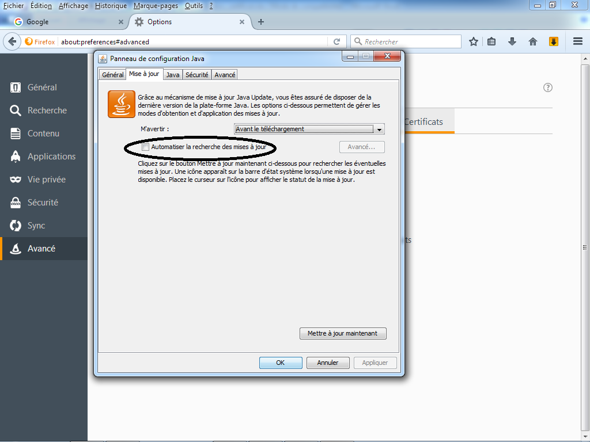

# Phase 3 — Installer et configurer Java

## Étape 8 — Installer Java 8 (32 bits) { #etape-8 }

[:material-download: jre-8u60-windows-i586.exe](https://drive.google.com/drive/folders/1UZJvKztSVTUchLILuPxfFBg5bT1W3Tur?usp=drive_link){ .md-button .md-button--primary .dl target="_blank" }

1. Téléchargez le fichier `jre-8u60-windows-i586.exe` depuis le [dossier Google Drive des fichiers d'installation](https://drive.google.com/drive/folders/1UZJvKztSVTUchLILuPxfFBg5bT1W3Tur?usp=drive_link){ target="_blank" }.
2. Double-cliquez sur le fichier téléchargé.
3. Suivez l'assistant d'installation jusqu'à la fin.

!!! info "Version 32 bits"
    Firefox 52 ESR et Basilisk étant des navigateurs 32 bits, Java doit lui aussi être en version 32 bits, y compris sur un Windows 64 bits.

!!! warning "Si vous utilisez Basilisk"
    Basilisk doit être installé **avant** Java ([étape 3](../navigateurs/index.md#etape-3)) pour que le module Java soit ajouté au navigateur.

## Étape 9 — Autoriser l'écriture sur le dossier Java { #etape-9 }

<figure markdown="span">
  { width="560" }
  <figcaption>Propriétés de : Java › Sécurité</figcaption>
</figure>

1. Ouvrez le dossier **C:\Program Files (x86)** (ou **C:\Program Files** sur un Windows 32 bits).
2. Faites un clic droit sur le dossier **Java** › **Propriétés** › onglet **Sécurité**.
3. Sélectionnez le groupe **Utilisateurs** puis cliquez sur **Modifier…**
4. Cochez **Autoriser** pour **Modification** et **Écriture**, comme sur la capture.
5. Cliquez sur **Appliquer** puis sur **OK**.

## Étape 10 — Ouvrir le panneau de configuration Java { #etape-10 }

<figure markdown="span">
  { width="560" }
  <figcaption>Windows › Menu Démarrer</figcaption>
</figure>

1. Cliquez sur le bouton **Démarrer** de Windows.
2. Dans le champ de recherche, tapez **configurer java**.
3. Cliquez sur **Configure Java**.

!!! info "À savoir"
    Ce panneau est utilisé jusqu'à la fin de cette phase. Gardez-le ouvert.

## Étape 11 — Ajouter INDIM@J aux sites autorisés par Java { #etape-11 }

<figure markdown="span">
  { width="760" }
  <figcaption>Java › Sécurité › Liste des sites avec exception</figcaption>
</figure>

1. Cliquez sur l'onglet **Sécurité**.
2. Cliquez sur **Modifier la liste des sites…**
3. Cliquez sur **Ajouter** et saisissez **https://indimaj.tgr.gov.ma**.
4. Cliquez sur **OK** pour valider.

<figure markdown="span">
  { width="560" }
  <figcaption>Résultat attendu : le lien apparaît dans la liste des sites avec exception</figcaption>
</figure>

## Étape 12 — Importer le certificat dans Java { #etape-12 }

<figure markdown="span">
  { width="760" }
  <figcaption>Java › Sécurité › Gérer les certificats</figcaption>
</figure>

1. Dans l'onglet **Sécurité**, cliquez sur **Gérer les certificats…**
2. Dans **Type de certificat**, sélectionnez **Authentification du client**.
3. Cliquez sur **Importer**.
4. Sélectionnez le fichier certificat **(.p12)** sauvegardé à l'[étape 7](../certificat/index.md#etape-7), puis cliquez sur **Ouvrir**.
5. Saisissez le **mot de passe de sauvegarde** du certificat.
6. Si un second mot de passe est demandé, cliquez sur **OK** sans rien saisir.

<figure markdown="span">
  { width="760" }
  <figcaption>Sélection du fichier certificat</figcaption>
</figure>

## Étape 13 — Vérifier les paramètres de sécurité avancés { #etape-13 }

<figure markdown="span">
  { width="560" }
  <figcaption>Java › Avancé › Paramètres de sécurité avancés</figcaption>
</figure>

| Option | État |
|--------|------|
| Activer l'environnement restreint (natif) du système d'exploitation | ☑ Cochée |
| Utiliser les certificats et les clés du fichier de clés du navigateur | ☑ Cochée |
| Activer la vérification de révocation de la liste noire | ☑ Cochée |
| Activer la mise en cache du mot de passe pour l'authentification | ☑ Cochée |
| Utiliser le format ClientHello compatible SSL 2.0 | ☐ Décochée |
| Utiliser TLS 1.0 | ☑ Cochée |
| Utiliser TLS 1.1 | ☑ Cochée |
| Utiliser TLS 1.2 | ☑ Cochée |

1. Cliquez sur l'onglet **Avancé**.
2. Faites défiler jusqu'à la section **Paramètres de sécurité avancés**.
3. Cochez ou décochez les options selon le tableau ci-dessus.
4. Cliquez sur **Appliquer**.

## Étape 14 — Désactiver la mise à jour de Java { #etape-14 }

<figure markdown="span">
  { width="760" }
  <figcaption>Java › Mise à jour</figcaption>
</figure>

1. Cliquez sur l'onglet **Mise à jour**.
2. Décochez **Automatiser la recherche des mises à jour**.
3. Cliquez sur **OK** pour fermer le panneau Java.

!!! warning "Important"
    Une mise à jour automatique de Java peut rendre INDIM@J inaccessible.
