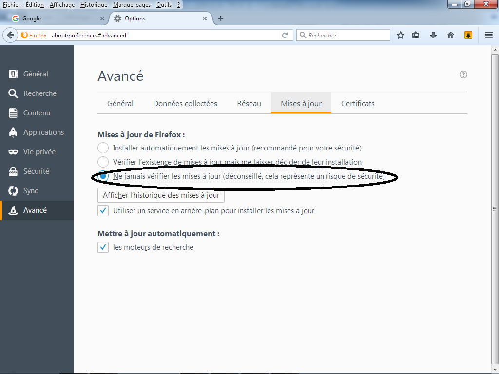

# Phase 1 — Installer les navigateurs

## Étape 1 — Installer Firefox 52 ESR { #etape-1 }

[:material-download: Firefox Setup 52.0.1esr.exe](https://drive.google.com/drive/folders/1UZJvKztSVTUchLILuPxfFBg5bT1W3Tur?usp=drive_link){ .md-button .md-button--primary .dl target="_blank" }

1. Téléchargez le fichier `Firefox Setup 52.0.1esr.exe` depuis le [dossier Google Drive des fichiers d'installation](https://drive.google.com/drive/folders/1UZJvKztSVTUchLILuPxfFBg5bT1W3Tur?usp=drive_link){ target="_blank" }.
2. Double-cliquez sur le fichier téléchargé.
3. Suivez l'assistant d'installation jusqu'à la fin.

!!! info "Pourquoi cette version"
    Firefox 52 ESR est la dernière version de Firefox compatible avec le module Java utilisé par INDIM@J. N'installez pas une autre version.

## Étape 2 — Désactiver la mise à jour de Firefox { #etape-2 }

<figure markdown="span">
  { width="760" }
  <figcaption>Firefox › Options › Avancé › Mises à jour</figcaption>
</figure>

1. Dans Firefox, ouvrez le menu **☰** puis **Options**.
2. Cliquez sur **Avancé**, puis sur l'onglet **Mises à jour**.
3. Sélectionnez **« Ne jamais vérifier les mises à jour »**.

!!! warning "Important"
    Une mise à jour automatique remplacerait Firefox 52 ESR par une version incompatible et rendrait INDIM@J inaccessible.

## Étape 3 — Installer Basilisk (32 bits) { #etape-3 }

Facultatif

[:material-download: basilisk-20261101213439.win32.installer.exe](https://dl.basilisk-browser.org/basilisk-20261101213439.win32.installer.exe){ .md-button .md-button--primary .dl }

1. Téléchargez Basilisk 32 bits à l'aide du bouton ci-dessus.
2. Double-cliquez sur le fichier téléchargé.
3. Suivez l'assistant d'installation jusqu'à la fin.

!!! info "À quoi sert Basilisk"
    Basilisk (32 bits) permet d'utiliser INDIM@J en alternative à Firefox 52 ESR. Cette étape est facultative.

!!! warning "Firefox reste obligatoire pour le certificat"
    Basilisk ne permet pas d'installer le certificat. La création et la sauvegarde du certificat ([phase 2](../certificat/index.md)) doivent être réalisées avec Firefox 52 ESR.

!!! warning "Ordre d'installation"
    Installez Basilisk **avant** Java ([phase 3](../java/index.md)) : le module Java n'est ajouté au navigateur que si celui-ci est déjà installé au moment de l'installation de Java. Si Java est déjà installé, réinstallez-le après Basilisk.
