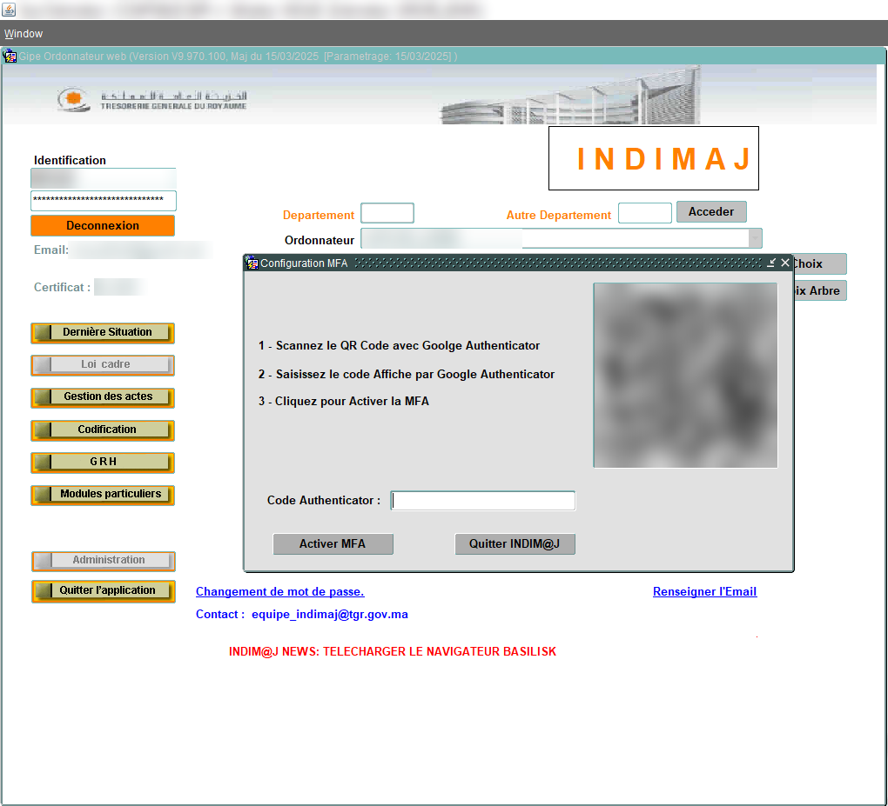
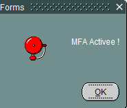
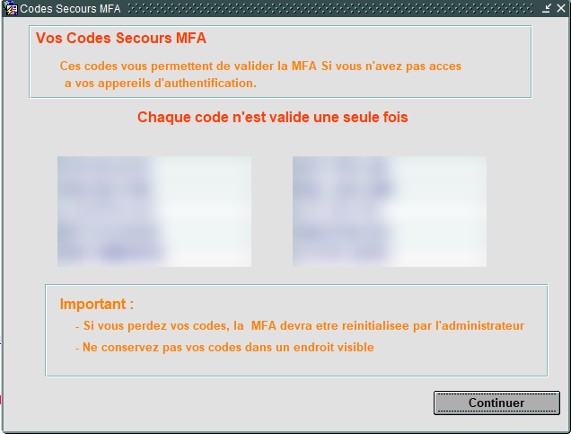
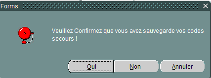

# Activation de la double authentification

## Étape 2 — Activer la double authentification

Cette étape se fait **une seule fois**. Lorsque la double authentification est activée pour votre compte, la fenêtre **Configuration MFA** s'affiche à votre prochaine connexion à INDIM@J.

<figure markdown="span">
  { width="760" }
  <figcaption>Fenêtre « Configuration MFA »</figcaption>
</figure>

!!! info "Captures d'écran"
    Sur les captures de ce guide, les informations personnelles sont floutées : votre écran affiche les vôtres.

1. Connectez-vous à INDIM@J comme d'habitude, avec votre identifiant et votre mot de passe. La fenêtre **Configuration MFA** s'affiche avec un **QR code** (un carré noir et blanc).
2. Sur votre téléphone, ouvrez **Google Authenticator**, appuyez sur **+**, puis sur **Scanner un code QR**.
3. Si le téléphone demande l'accès à l'appareil photo, appuyez sur **Autoriser**.
4. Pointez l'appareil photo vers le QR code affiché sur l'écran de l'ordinateur. Tenez le téléphone immobile : le QR code est lu automatiquement.
5. Une nouvelle ligne apparaît dans l'application, avec un code de **6 chiffres**.
6. Sur l'ordinateur, tapez ces 6 chiffres dans la case **Code Authenticator**, sans espace.
7. Cliquez sur **Activer MFA**.

!!! tip "Le code change toutes les 30 secondes"
    Un petit cercle à côté du code indique le temps restant. S'il est presque vide, attendez le code suivant avant de le taper.

Si le code est correct, le message **MFA Activee !** s'affiche. Cliquez sur **OK**.

<figure markdown="span">
  { width="240" }
  <figcaption>Message de confirmation</figcaption>
</figure>

!!! danger "Ne partagez jamais le QR code"
    Ne photographiez pas le QR code et ne l'envoyez à personne : il donne accès à votre compte.

## Étape 3 — Noter vos codes de secours

Juste après l'activation, INDIM@J affiche **10 codes de secours**. Ils vous permettent de vous connecter si vous n'avez pas votre téléphone : oubli, panne ou perte.

<figure markdown="span">
  { width="560" }
  <figcaption>Fenêtre « Codes Secours MFA » (codes masqués)</figcaption>
</figure>

1. Recopiez **les 10 codes** sur une feuille de papier, sans erreur.
2. Rangez cette feuille dans un endroit sûr : un tiroir fermé, un dossier personnel. Ne la collez pas sur l'écran ni sur le bureau.
3. Cliquez sur **Continuer**.
4. Un message vous demande de confirmer que vous avez sauvegardé vos codes. Cliquez sur **Oui** uniquement si vous avez bien noté les 10 codes.

<figure markdown="span">
  { width="427" }
  <figcaption>Confirmation de la sauvegarde des codes de secours</figcaption>
</figure>

!!! warning "À retenir"
    - Chaque code ne fonctionne **qu'une seule fois**.
    - Gardez vos codes **loin de votre téléphone** : s'il est perdu, vos codes restent disponibles.
    - Si vous perdez vos codes, la double authentification doit être réinitialisée (voir [« En cas de problème »](../assistance/index.md)).

!!! success "C'est terminé"
    Votre compte est maintenant protégé par la double authentification.
