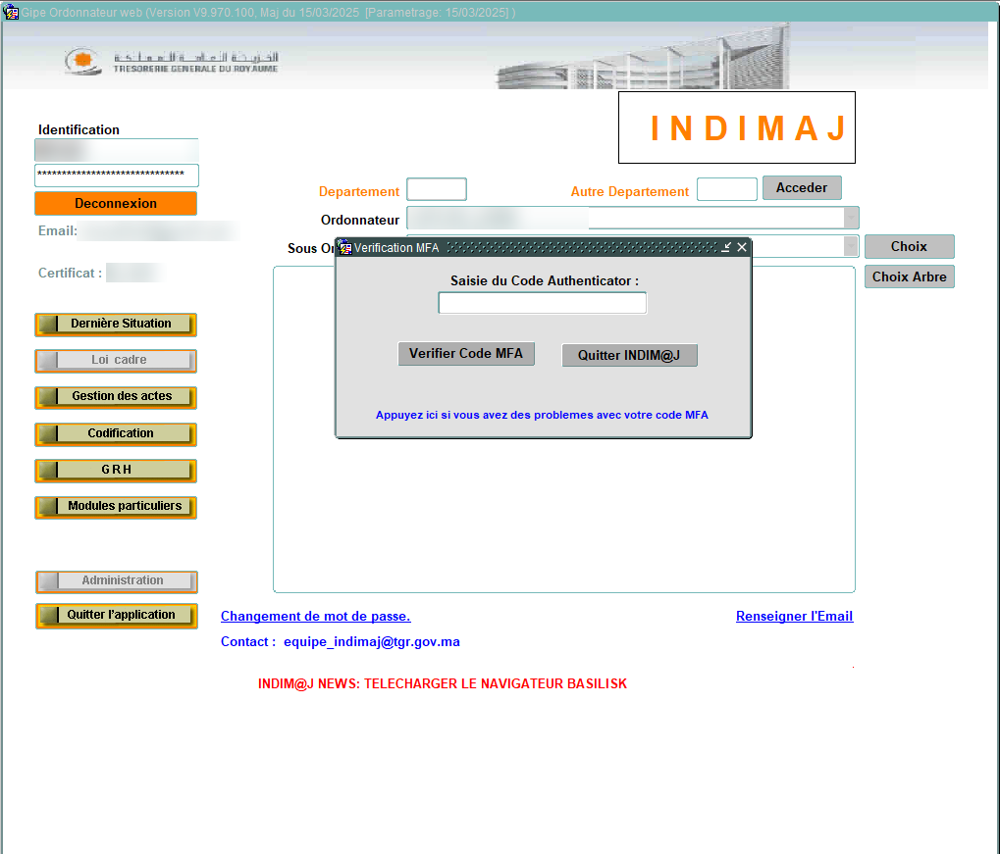
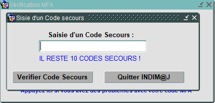

# Se connecter au quotidien

## Se connecter les jours suivants

À **chaque connexion** à INDIM@J, après votre mot de passe, la fenêtre **Vérification MFA** s'affiche.

<figure markdown="span">
  { width="760" }
  <figcaption>Fenêtre « Vérification MFA »</figcaption>
</figure>

1. Ouvrez **Google Authenticator** sur votre téléphone.
2. Lisez le code de 6 chiffres affiché.
3. Tapez-le dans la case **Saisie du Code Authenticator**.
4. Cliquez sur **Verifier Code MFA**.

!!! info "Pas besoin d'Internet sur le téléphone"
    Google Authenticator fonctionne même sans connexion Internet ni réseau mobile.

## Pas de téléphone sous la main ? Utilisez un code de secours

1. Dans la fenêtre **Vérification MFA**, cliquez sur le lien bleu **Appuyez ici si vous avez des problemes avec votre code MFA**.
2. La fenêtre **Saisie d'un Code Secours** s'affiche.
3. Tapez **un** de vos codes de secours, exactement comme il est écrit sur votre feuille.
4. Cliquez sur **Verifier Code Secours**.
5. Barrez ce code sur votre feuille : il ne fonctionnera plus.

<figure markdown="span">
  { width="426" }
  <figcaption>Fenêtre « Saisie d'un Code Secours » : le nombre de codes restants est indiqué en bleu</figcaption>
</figure>

!!! warning "Il vous reste peu de codes ?"
    La fenêtre indique combien de codes il vous reste. Quand il en reste peu, ou si vous n'avez plus votre téléphone, demandez une réinitialisation (voir [« En cas de problème »](../assistance/index.md)).
