# Renouvellement du certificat

Ce guide permet de remplacer un certificat d'accès expiré, en 7 étapes.

!!! warning "Navigateur obligatoire"
    Le renouvellement doit être réalisé avec **Firefox 52 ESR** : Basilisk ne permet pas d'installer le certificat.

## Étape 1 — Reconnaître un certificat expiré { #r1 }

<figure markdown="span">
  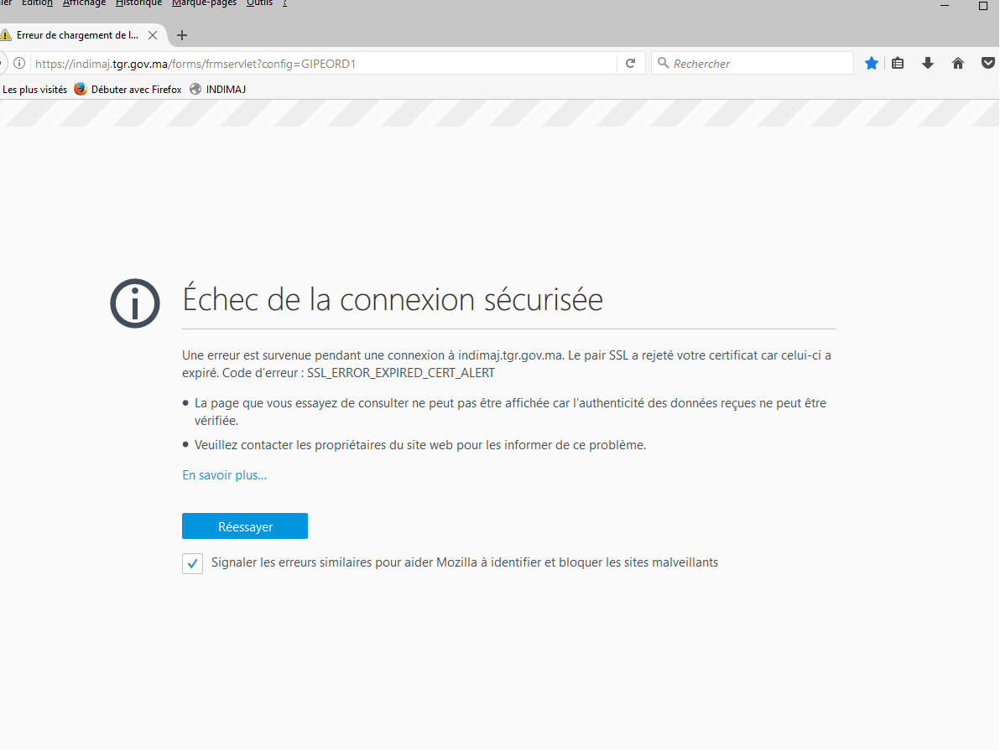{ width="760" }
  <figcaption>https://indimaj.tgr.gov.ma — Échec de la connexion sécurisée</figcaption>
</figure>

!!! danger "Message affiché par Firefox"
    À la connexion à INDIM@J, Firefox affiche **« Échec de la connexion sécurisée »** avec le message *« Le pair SSL a rejeté votre certificat car celui-ci a expiré »* et le code d'erreur `SSL_ERROR_EXPIRED_CERT_ALERT`.

!!! info "Que faire"
    Votre certificat d'accès a expiré. Cliquer sur « Réessayer » ne résout pas le problème : renouvelez le certificat en suivant les étapes ci-dessous.

## Étape 2 — Se connecter au portail du certificat { #r2 }

<figure markdown="span">
  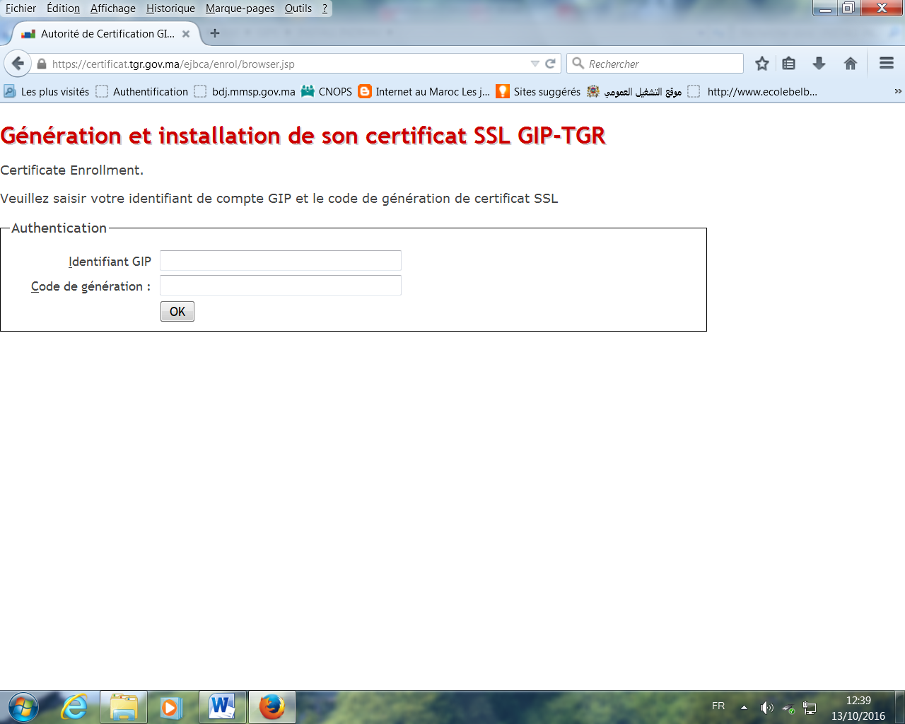{ width="760" }
  <figcaption>https://certificat.tgr.gov.ma</figcaption>
</figure>

1. Dans **Firefox**, accédez à l'adresse **[https://certificat.tgr.gov.ma](https://certificat.tgr.gov.ma){ target="_blank" }**.
2. Saisissez votre **Identifiant GIP** et votre **Code de génération**.
3. Cliquez sur **OK**.

!!! info "Bon à savoir"
    L'identifiant GIP et le code de génération sont normalement identiques à votre login INDIM@J.

## Étape 3 — Générer le nouveau certificat { #r3 }

<figure markdown="span">
  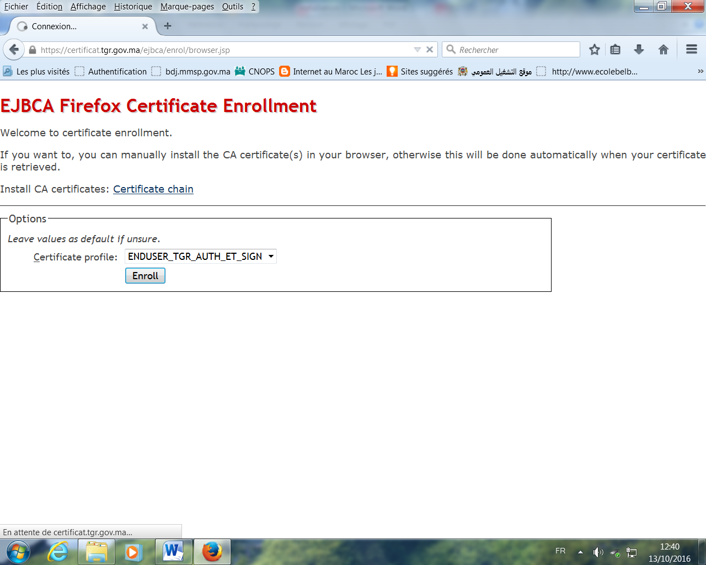{ width="760" }
  <figcaption>EJBCA Firefox Certificate Enrollment</figcaption>
</figure>

1. Laissez le profil proposé par défaut : **ENDUSER_TGR_AUTH_ET_SIGN**.
2. Cliquez sur **Enroll**.
3. La page **Certificate Created** confirme la création du certificat.
4. Une alerte indique que le certificat personnel a été installé : cliquez sur **OK**.

<figure markdown="span">
  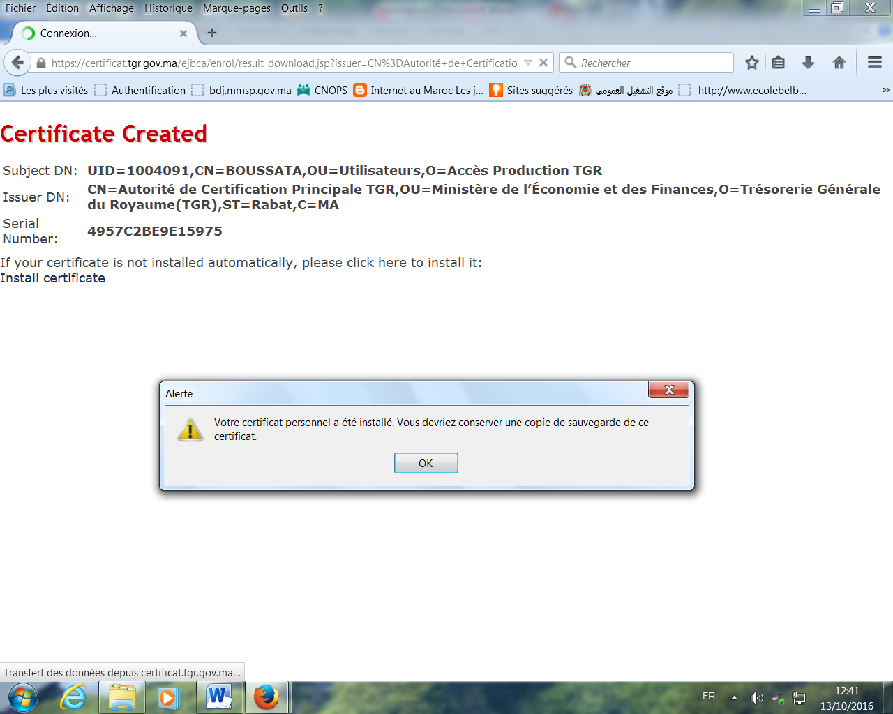{ width="760" }
  <figcaption>Résultat attendu : le nouveau certificat est créé puis installé automatiquement dans Firefox</figcaption>
</figure>

## Étape 4 — Ouvrir le gestionnaire de certificats de Firefox { #r4 }

<figure markdown="span">
  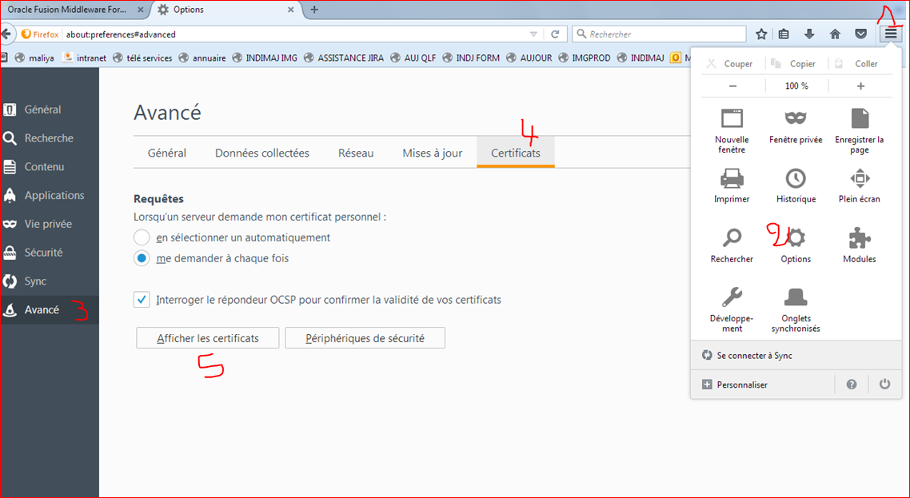{ width="760" }
  <figcaption>Firefox › Options › Avancé › Certificats</figcaption>
</figure>

1. Ouvrez le menu **☰** en haut à droite de Firefox.
2. Cliquez sur **Options**.
3. Cliquez sur **Avancé**…
4. … puis sur l'onglet **Certificats**.
5. Cliquez sur **Afficher les certificats**.

## Étape 5 — Sauvegarder le nouveau certificat { #r5 }

<figure markdown="span">
  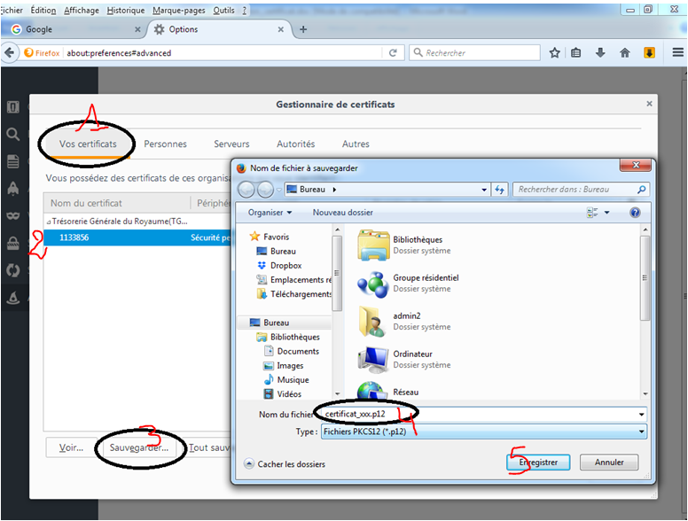{ width="760" }
  <figcaption>Gestionnaire de certificats › Vos certificats</figcaption>
</figure>

1. Cliquez sur l'onglet **Vos certificats**.
2. Sélectionnez le **nouveau certificat** (le plus récent).
3. Cliquez sur **Sauvegarder…**
4. Choisissez un emplacement, donnez un nom au fichier, puis cliquez sur **Enregistrer**.
5. Saisissez deux fois un **mot de passe de sauvegarde** (les champs peuvent être laissés vides), puis cliquez sur **OK**.
6. Le message **Sauvegarde des certificats et clés privées réussie** s'affiche : cliquez sur **OK**.

<figure markdown="span">
  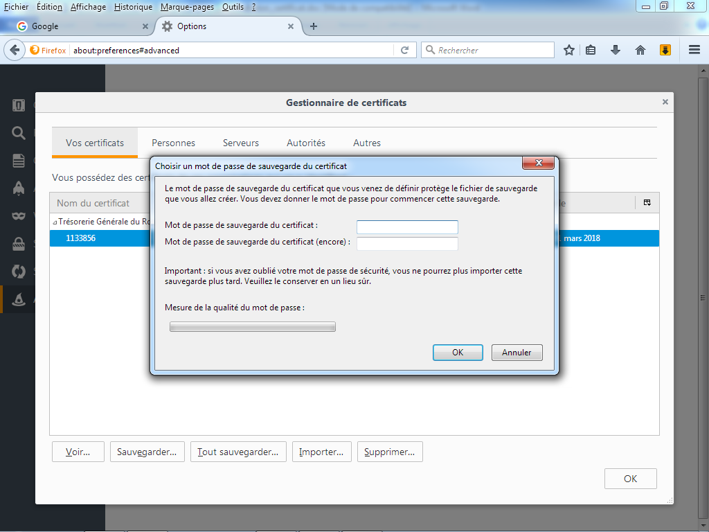{ width="560" }
  <figcaption>Mot de passe de sauvegarde</figcaption>
</figure>

<figure markdown="span">
  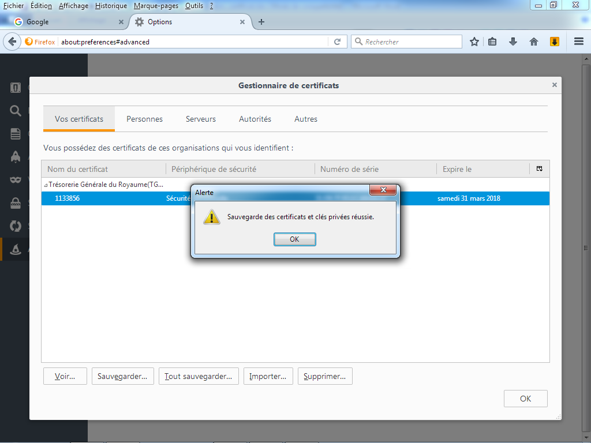{ width="560" }
  <figcaption>Résultat attendu : la sauvegarde du certificat et des clés privées a réussi</figcaption>
</figure>

!!! warning "À retenir"
    Notez l'emplacement du fichier (.p12) et le mot de passe de sauvegarde : ils sont demandés à la [dernière étape](#r7).

## Étape 6 — Ouvrir le panneau Java et vérifier les options { #r6 }

<figure markdown="span">
  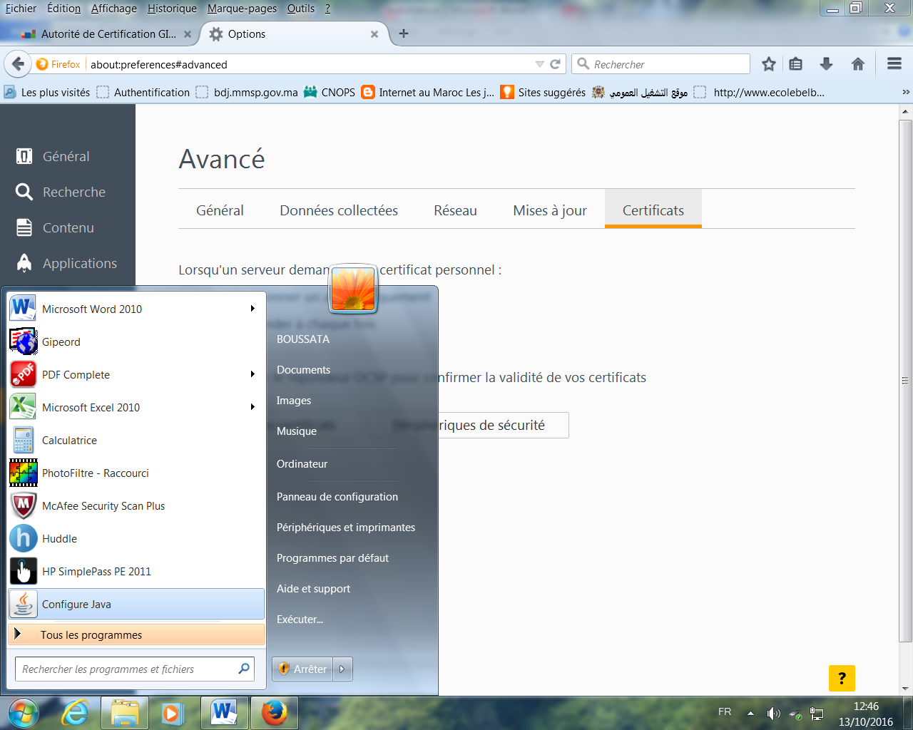{ width="560" }
  <figcaption>Windows › Menu Démarrer</figcaption>
</figure>

1. Cliquez sur le bouton **Démarrer** de Windows.
2. Dans le champ de recherche, tapez **configurer java**, puis cliquez sur **Configure Java**.
3. Cliquez sur l'onglet **Avancé** et vérifiez les **Paramètres de sécurité avancés** selon le tableau ci-dessous.
4. Cliquez sur **Appliquer**. Gardez le panneau Java ouvert.

<figure markdown="span">
  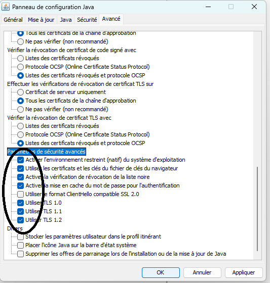{ width="560" }
  <figcaption>Java › Avancé › Paramètres de sécurité avancés</figcaption>
</figure>

| Option | État |
|--------|------|
| Activer l'environnement restreint (natif) du système d'exploitation | ☑ Cochée |
| Utiliser les certificats et les clés du fichier de clés du navigateur | ☑ Cochée |
| Activer la vérification de révocation de la liste noire | ☑ Cochée |
| Activer la mise en cache du mot de passe pour l'authentification | ☑ Cochée |
| Utiliser le format ClientHello compatible SSL 2.0 | ☐ Décochée |
| Utiliser TLS 1.0 | ☑ Cochée |
| Utiliser TLS 1.1 | ☑ Cochée |
| Utiliser TLS 1.2 | ☑ Cochée |

## Étape 7 — Remplacer l'ancien certificat dans Java { #r7 }

<figure markdown="span">
  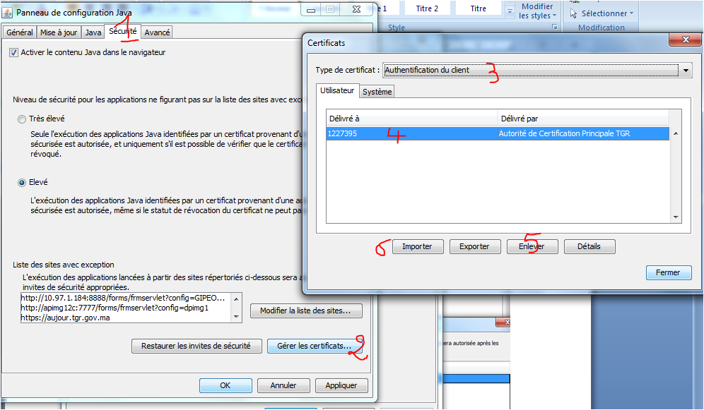{ width="760" }
  <figcaption>Java › Sécurité › Gérer les certificats</figcaption>
</figure>

1. Cliquez sur l'onglet **Sécurité**.
2. Cliquez sur **Gérer les certificats…**
3. Dans **Type de certificat**, sélectionnez **Authentification du client**.
4. Sélectionnez l'**ancien certificat**.
5. Cliquez sur **Enlever**. Si un mot de passe est demandé, cliquez sur **OK**.
6. Cliquez sur **Importer**, puis sélectionnez le **nouveau certificat** sauvegardé depuis Firefox.
7. Saisissez le **mot de passe de sauvegarde** du certificat.
8. Lorsque le mot de passe est demandé une deuxième fois, cliquez sur **OK** sans rien saisir.
9. Cliquez sur **Fermer**, puis sur **OK**.

!!! success "Certificat renouvelé"
    Fermez puis rouvrez le navigateur, et reconnectez-vous à INDIM@J.
